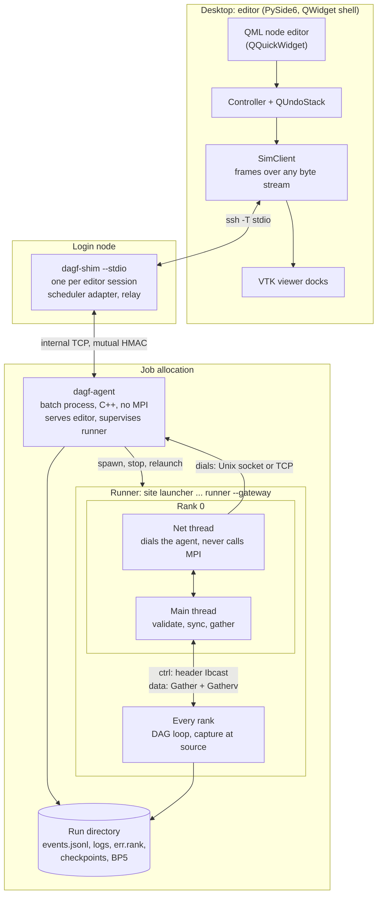
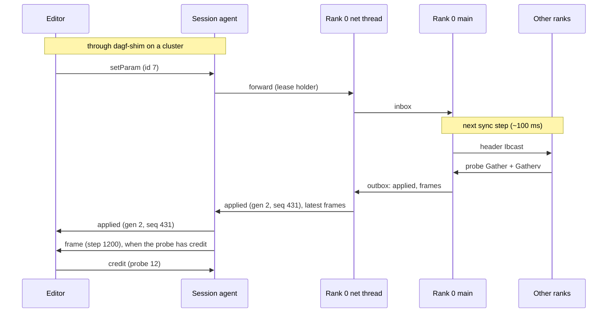

# DAG Flow Architecture Blueprint

**As of:** 2026-11-03 (final)
**Scope:** an existing C++/MPI headless DAG runner, extended so a desktop node editor (Python, PySide6) can author graphs, launch and control runs on a workstation or a cluster, and view node outputs live.
**Status:** final. Refined over seven review rounds: control plane, geometry path and data plane (rounds 1–3); OpenVDB sizing and tuning (round 4, section 12); physics and solver plan against the state of the art (round 5, section 13); convergence, acceleration, MOOSE FV settings and digital-twin operation (round 6, section 14); session layer, carriers and the in-house editor decision (round 7, sections 3–5 and 8.1), followed by a full consistency pass. Part II, the implementation handbook, was added on 2026-11-03 and revised after an independent implementability review (30 findings, all fixed). Integration levels 0–3 were added the same day, so the first release works with the binary unchanged (H4.0, phase 2a). Where this file disagrees with earlier plans or docs, this file wins.

**How to read it.** Part I decides. Sections 1–11 are the platform: how the editor, the session agent and the runner fit together, move data and evolve. Sections 12–14 are the compute track: sparse geometry, physics, solvers and twin operation inside the runner. Section 15 lists sources. Part II (H0–H15) is the implementation handbook: exact wire formats, state machines, algorithms with worked numbers, test vectors and phase plans with acceptance tests, written so an implementing agent such as Claude Code can build the platform without guessing. Implementers start at H0.

**Contents.** Part I: 1 Decisions at a glance · 2 System overview · 3 Processes, sessions and lifecycle · 4 Control plane · 5 Wire format, carriers and security · 6 Data plane: live probes · 7 Disk · 8 Live rendering · 9 Build order · 10 Decision log · 11 Risks and open questions · 12 OpenVDB track · 13 Final architecture: geometry, physics, solvers and coupling · 14 Convergence assurance, acceleration, FV settings and twin operation · 15 Sources. Part II: H0–H15 implementation handbook

---

## 1. Decisions at a glance

| Area | Decision | Rejected alternative |
| --- | --- | --- |
| Engine | One binary: the existing runner, unchanged at level 0; opt-in flags at higher levels (`--dump-registry`, `--validate`, `--progress-file`, `--gateway`) | A second "GUI sim" binary |
| Integration depth | Four opt-in levels (Part II H4.0): 0 no change to the binary; 1 registry dump, validation and a progress file; 2 the gateway (pause, step, tunable parameters); 3 live probes. Start with 0–1; add 2 and 3 when someone needs them | Requiring the gateway from the start |
| Who owns what | The runner owns the graph (nodes, links, params) and run state; the session agent owns the session (connection, lease, logs, editor layout); the editor is a view | Editor-owned graph pushed to the sim |
| Session lifecycle | A per-job session agent (`dagf-agent`, C++, no MPI): the job's batch process, parent of the MPI launcher, serves the editor, relaunches the runner inside the allocation | The runner serving the GUI directly; a shared broker or login-node daemon; a restartable agent that re-adopts runners |
| Cluster access | One long-lived `ssh -T` per editor session to a stdio shim (`dagf-shim`) on the login node; submit, status and attach travel as frames on that pipe | Hand-made tunnels; ports opened on the laptop; ControlMaster-dependent short-lived commands |
| Runner's endpoint | Rank 0's pinned net thread dials the agent (node-local Unix socket, or TCP with the same handshake if rank 0 lands on another node); it never calls MPI | The runner listening on the network; every rank serving the GUI |
| Rank coordination | Ranks meet only at sync steps scheduled by rank 0 | A broadcast every step |
| Control traffic | Fixed-size header, `MPI_Ibcast` on a duplicated control communicator, on every rank | Blocking broadcast mixed with node collectives |
| Wire format | Own frames (length-prefixed JSON header plus raw payload) after an 8-byte preamble | WebSocket, gRPC, ZeroMQ, an IDL |
| Authentication | Mutual HMAC challenge–response with fresh nonces on every connection, one secret per job; Unix sockets also check the peer's uid | Bearer tokens; trusting localhost |
| Schemas | Hand-written: graph file, message envelope, frame prefix. Generated: node types | An IDL; hand-written node schemas |
| Live data | Reduced at the source on every rank, fanned in to rank 0 with `MPI_Gather` + `MPI_Gatherv` at sync | Full-resolution parts sent to rank 0; parallel-filesystem round trip |
| Live flow control | The controller sets `max_hz` per subscription; rank 0 pushes the latest frame per probe to the agent; the agent pushes latest-only with one credit per probe per client | Pushing every sync to the editor; cadence from observed pull rate; compression |
| Precision | float32 by default; u16 with per-block scale and offset when over budget; float32 always when paused | fp16; quantizing against a global range |
| Disk | v1.5 snapshots, v2 rotating history: ADIOS2 BP5 written from the main thread at sync, VTX or Fides schema | Background writer thread under `FUNNELED`; XDMF sidecar; file-per-rank |
| Viewer | QWidget shell: QML node editor in a `QQuickWidget`, VTK viewer docks, OpenGL everywhere | Qt Quick 3D as the scientific viewport |
| Node editor | Built in-house on the Godot `GraphEdit` pattern; PyFlow (Apache-2.0) and Godot's source used as references for interactions and connection rules | PyFlow or NodeGraphQt as the editor: both own and change their own graph model, while ours may change only from runner events |
| Heavy visualization | Catalyst 2 output node (ParaView Live) in v2; trame or pvserver remote rendering in v3 | A hand-built remote renderer; Omniverse/IndeX exports (OpenVDB export is back for the VDB track, section 12) |
| Errors | v1: a node error writes diagnostics and calls `MPI_Abort`; the agent reports exit status and full logs and can relaunch from a checkpoint; `mpi_free` nodes may fail softly | `skip()` mirroring collectives with dummy data |
| Topology edits | v1: stop and relaunch inside the same allocation (no requeue). v2: while paused, broadcast the canonical graph and rebuild | Live topology edits while running; a new job per edit |
| Sparse volumes (OpenVDB track) | OpenVDB 14 (13.2 fallback) per rank: 128³ blocks on a Hilbert curve, leaf halos on `vdb_comm`; float compute, half/u16 storage and transport; per-tool memory multipliers drive the planner (section 12) | Dense fields at 8K; fVDB as the core; one monolithic `.vdb` |
| Physics and solvers | VDB holds the 8192³ geometry; PDEs run on adaptive meshes at 10⁷–10⁹ unknowns in MOOSE (in-process, backend per node) and wrapped solvers; bulk matrix-free multigrid, band assembled; coupling by quasi-Newton-accelerated implicit coupling with waveform iteration (section 13) | Dense 8192³ PDEs; own matrix-free FV node; Picard at sync steps |
| Convergence and acceleration | Galerkin coarse operators and patch smoothers wherever the band or cut cells are; band on the Neumann side of any partitioned coupling; Fischer initial guesses, Krylov recycling, damped Anderson, inexact Newton as free defaults; two-level coarse spaces (GenEO/GDSW/MsFEM) as the band's multiscale basis (section 14) | Kernel-convolution solves; H²-matrices for PDE inverses; POD deflation; Gaussian-splatting-style solvers |
| Digital-twin operation | Versioned VDB geometry as twin state; localised re-solves through field-split condensation with reused factors; a surrogate ladder with residual gates; adjoint calibration and ensemble assimilation; multilevel Monte Carlo across the ladder (section 14.5) | Full re-solve per update; ungated surrogates; real-time promises on the high-fidelity rung |

---

## 2. System overview



Three kinds of traffic share each stream:
- **Session:** submit, status, attach, relaunch, release, logs, takeover. Handled by the shim and the agent; never reaches the ranks.
- **Control:** graph and run commands, replies, outcomes and state events. Small, never dropped, always sent ahead of data.
- **Data:** probe frames (slices, decimated volumes, stats, values), node stats and heartbeats. Latest wins, droppable.

For local runs the shim disappears: the editor starts the same agent on the desktop and connects to its Unix socket.

With an unmodified runner (levels 0–1), the runner has no net thread and never connects. The agent runs it as a plain child, stops it with a signal, relaunches it with edited graphs, and turns its logs, progress file and output files into progress frames and `outputWritten` events. Control and live data (sections 4 and 6) start at level 2.

---

## 3. Processes, sessions and lifecycle

### 3.1 Components

| Component | Runs on | Lifetime | Responsibility |
| --- | --- | --- | --- |
| Editor | Desktop | User session | Authoring, control, viewing |
| `dagf-shim --stdio` | Login node, started by the editor over `ssh -T` | The editor session | Scheduler adapter (submit, status, cancel, end time, launch template); relays frames to the agent; one per editor session |
| `dagf-agent` | Batch host of the job (the desktop for local runs) | The allocation (local runs: until released or idle) | Serves the editor; spawns, stops and relaunches the runner; keeps logs, events and the latest frames; deadline and idle timers; in plain mode, watches logs, progress and output files |
| `runner --gateway` | All nodes of the allocation | One run (a *generation*); relaunched by the agent | Executes the DAG; sync steps, probes, disk |

The agent and the shim are built from the runner's source tree as small C++ executables that do not link MPI. They share the framing code with the runner and are versioned with it, so the cluster side has one implementation of the protocol. The editor has the second, in Python.

### 3.2 Runner modes

| Invocation | Uses MPI | Lifetime | Purpose |
| --- | --- | --- | --- |
| `runner graph.json` | Yes | Runs to the end | Today's headless run, unchanged |
| `runner graph.json --gateway unix:<path>,tcp:<host:port> --secret-file <file> --gen <G>` | Yes | One generation | Same run; rank 0 dials the agent (the Unix socket when it shares the agent's node, else TCP) and authenticates with the per-job secret, which the agent writes to a 0600 file in the run directory before spawning the launcher |
| `runner graph.json --progress-file <path>` | Yes | Runs to the end | Level 1: today's run plus one progress line from rank 0 at most every 0.5 s; never waits |
| `runner --dump-registry` | No | Exits at once | Level 1: node types for the editor's palette (level 0 uses a hand-written list) |
| `runner --validate graph.json` | No | Exits at once | Level 1: the runner's own checks, on a laptop or login node |

### 3.3 States

Two layers:
- **Job (agent):** queued → starting → held (agent up, no runner) ⇄ running a generation → releasing → ended.
- **Run (runner):** waiting, running, paused, finished, stopping.

Rules:
- A new generation starts **waiting** so the editor can attach first; `--autostart` skips that.
- A **finished** run stays up so users can inspect results or run again; on `stop` the runner exits and the agent holds the allocation with no runner.
- **Idle release:** the agent ends the job after a configurable idle time (default 45 minutes) with no editor attached and no runner actively running (a waiting, paused or finished runner counts as idle; a running one never does). The remaining idle time and walltime show on attach, so a laptop that slept does not silently lose an allocation that waited hours in the queue.
- **Detach:** `--on-detach=continue|pause|stop` is the agent's policy; it sends the matching command to the runner when the editor disconnects.

### 3.4 Local run
1. The editor creates a run directory and writes `graph.json`.
2. It starts `dagf-agent --local --run-dir RUN --launch "mpirun -n N" -- <runner> RUN/graph.json` as a detached process. The agent creates a private socket directory (`mkdtemp`, mode 0700), listens there, and writes a local rendezvous file `~/.runner/jobs/local-<id>.json` (0600) with the socket path and the secret.
3. The agent spawns the launcher with `stdin` from `/dev/null` and full logs in the run directory, and waits for rank 0 to dial in.
4. The editor connects with `QLocalSocket`, completes the handshake, sends `hello`, takes a snapshot and subscribes its views. Closing the editor applies `--on-detach`; reopening it finds the run through the local rendezvous file.

### 3.5 Cluster run
1. **Connect once.** The editor starts one `ssh -T <login> /abs/path/dagf-shim --stdio` for the whole session. An absolute path avoids the module `PATH` changes that non-interactive shells skip. MFA prompts go through `SSH_ASKPASS`, once. No ControlMaster is needed, so this also works with Windows OpenSSH.
2. **Submit.** The editor sends `submit {graph, nodes, ranks, walltime, …}`. The shim's scheduler adapter writes the batch script from the site profile's launch template, submits it and returns the job id. The editor shows the job as queued; `status` frames refresh it.
3. **Start.** The batch script ends in `exec dagf-agent --run-dir RUN --launch "<site launcher>" -- <runner> RUN/graph.json`, so the agent is the batch process itself. The agent:
   - creates a per-job secret (kept across runner generations), listens on a Unix socket in a `mkdtemp` directory for rank 0, and binds a TCP port on its host's internal address, the one login nodes resolve (never `0.0.0.0`);
   - writes `~/.runner/jobs/<job id>.json` (file 0600, directory 0700) with host, port and the secret;
   - spawns the site launcher (`srun` preferred over `mpirun`) with `stdin` from `/dev/null` and full stdout and stderr logged to the run directory.
4. **Attach.** The editor sends `attach <job id>`. The shim first confirms with the scheduler that the job is running, then reads the rendezvous file (retrying briefly, because NFS attribute caching can delay it). It opens TCP to the agent, completes the mutual handshake (section 5.4) and relays frames in both directions.
5. **Drop and reattach.** On missed heartbeats, the editor restarts the SSH pipe if needed, asks for `status` and reattaches.

Deferred to phase 8 (v3): attaching through `ssh -J <login> <node>` where the site allows SSH into nodes running your job, which would let the agent stop listening on the network.

### 3.6 Relaunch inside the allocation
- **When:** a topology edit in v1, a restart after an abort, a restart from a checkpoint, or a new run of a different graph.
- **Flow:** the editor sends `relaunch {graph, from_checkpoint?}`. The agent sends `stop` to the runner (which writes outputs or a checkpoint), waits for exit with a timeout, then signals the launcher if needed. It spawns the new runner with generation + 1, re-subscribes the probes it holds, and tells the editor `runnerStarted {generation}`. The editor then takes a fresh snapshot.
- **Cost:** MPI start-up and data load, not a queue wait.
- **Limit:** the node and rank count are fixed by the allocation. A different size needs a new job.

### 3.7 Failure and shutdown

| Event | What happens |
| --- | --- |
| Runner crashes or aborts | The agent collects the exit status with `waitpid`, attaches the full logs and any `err.<rank>` files, sends `runnerExited {generation, status}` and holds the allocation. The editor offers relaunch, from a checkpoint if one exists |
| Agent dies | The batch process is gone, so the scheduler ends the job. Rank 0 sees end-of-file on its agent socket, broadcasts stop at the next sync, writes a checkpoint if one fits in the scheduler's kill grace period, and exits. The agent is kept small and tested so this is rare; there is no restart or re-adoption |
| Walltime approaches | The agent runs a deadline timer from the job's end time (from the scheduler adapter). At end time minus the measured checkpoint time plus a margin, it asks the runner to checkpoint and stop. Slurm's `--signal=B:USR1@<lead>` reaches the agent directly, because the agent is the batch process, and serves as an extra early warning; PBS and LSF rely on the timer |
| Idle timeout | The agent stops a waiting, paused or finished runner and exits, ending the job |
| Editor or SSH drops | Only the `--on-detach` command reaches the runner; the agent waits for a reattach |
| Release or cancel | `release` makes the agent stop the runner and exit; `cancel` goes through the scheduler adapter |

---

## 4. Control plane

This section applies at level 2 and above (Part II H4.0). At levels 0–1 the only control is the agent's stop signal and relaunch.

### 4.1 Sync point

Rank 0 picks each next sync step to hit a wall-clock target (default about 100 ms). Between syncs no rank makes any control or probe collective.

```cpp
struct ControlHeader {             // sketch; exact 256-byte layout in Part II H4.4
  uint32_t flags;                  // run, pause, stop, publish, snapshot, checkpoint, rebalance
  uint64_t next_sync_step;         // when the ranks meet again
  uint64_t graph_hash;             // replica check, release builds too
  uint32_t probe_table_rev;        // changes when subscriptions change
  uint32_t payload_len;            // > 0: a second Ibcast follows
  std::byte inline_data[192];      // tunable param values fit here
};
```

At each sync, on the main thread of every rank, in this fixed order:
1. `MPI_Ibcast` of the header on `ctrl` (root included), completed with `MPI_Test` and a short sleep while paused.
2. Optional payload `MPI_Ibcast` (probe table, tunable values, or the canonical graph in v2).
3. Apply tunable params; apply graph edits only when paused (v2).
4. Fan-in on `data` (section 6.3) when any probe captured since the last sync; and, when the header flags publish, the reductions of per-node timing, per-rank memory (`ru_maxrss` and live-grid bytes, for the memory planner in section 12.6) and soft-error flags (Part II H4.8).
5. Scheduled heavy work, in this order when the header flags it: VDB rebalance (section 12), `.vdb` checkpoint (section 12.5), BP5 snapshot (section 7).
6. Rank 0 hands frames and events to the net thread, which sends them to the agent.

`ctrl` and `data` are both `MPI_Comm_dup` of `MPI_COMM_WORLD`. Node collectives never touch them.

### 4.2 Command lifecycle
1. The editor sends `{id, cmd}` and draws a ghost for a pending edit.
2. The agent handles session commands itself (`relaunch`, `release`, `logs`, `takeover`); queue commands (`submit`, `status`, `cancel`) belong to the shim. The agent forwards graph and run commands to the runner only from the client holding the control lease.
3. Rank 0 replies `res ok:true` (accepted: validated and queued) or `res ok:false` with a code (rejected).
4. After the next sync (or at once when paused), the runner sends `applied` with its `(generation, seq)`, or `failed` with code and rank. Events carry `cause: {session, id}`.
5. The editor pushes the undo entry only after `applied`. Inverse commands carry a precondition; a failed precondition clears the undo stack.

v1 has one controller per job with explicit takeover; read-only observers arrive in v2. In v1, structural edits never reach the runner: the editor collects them in a local draft and applies them with `relaunch` (Part II H7.5). While running, only params flagged `tunable` in the registry are editable; structural edits return `requires_stop`, and the editor offers stop-and-relaunch.

### 4.3 Errors
- v1: a node error writes `err.<rank>` in the run directory, then calls `MPI_Abort`. The agent records it in `events.jsonl` and reports it with the exit status and full logs (section 3.7).
- Nodes flagged `mpi_free` may fail softly: outputs are marked invalid, the flag rides the next publish sync (at most about 0.5 s later), and the run pauses.
- The net thread never calls MPI or anything that might (loggers included). Check `provided` from `MPI_Init_thread`.

### 4.4 Sequence numbers, resume and snapshots
- Every runner event carries `(generation, seq)`; the agent passes both through unchanged.
- The agent keeps a ring buffer of recent events for the current generation. A client that reconnects within the same generation resumes from its last `seq`.
- A gap, or a new generation, means the client fetches a snapshot from the runner (graph, run state, latest `seq`). When no runner is running, the agent answers with the last graph, the job state and the last exit record.
- `hello` carries a session id, the protocol major version and a feature list. Retries reuse command ids; the agent caches results by id, so nothing applies twice.

### 4.5 Interaction sequence



Neither side ever blocks on the other: the runner picks up commands at its next sync, and replies, events and frames go out as soon as they exist. While paused or finished, rank 0's main thread waits on its inbox, so commands apply at once.

### 4.6 What happens when you act

| You do | Path | Takes effect |
| --- | --- | --- |
| Run, pause, step, stop | Agent → rank 0 inbox → flag in the next sync header | Next sync (about 100 ms); at once while paused |
| Change a tunable param | Same path; the value rides in the header | Next sync |
| Add, remove or connect nodes | v1: `relaunch` with the edited graph; v2: applied while paused | v1: after MPI start-up and data load; v2: at once |
| Click a node to view it | `subscribe(max_hz)` → probe table in the next header → captured → gathered at the following sync → pushed to the agent → sent when the probe has credit | About two syncs, plus transfer time |
| Move a node, add a comment | Stored by the agent in the graph file's `editor` section; never reaches the ranks | At once |
| Close the editor | The agent applies `--on-detach` | At once |
| Reopen | Shim → agent: resume within the generation, or a snapshot | Seconds |
| Release | The agent stops the runner and exits; the job ends | Within the stop timeout |

---

## 5. Wire format, carriers and security

### 5.1 Preamble and frames

Every stream starts with an 8-byte preamble in both directions, then frames:

```
preamble  "DAGF"  u16 major  u16 minor          sent once by each end
frame     u32 frame_len   bytes after this field, little-endian, capped
          u32 header_len  bytes of JSON header
          ...  header     UTF-8 JSON
          ...  payload    optional raw bytes, 64-byte aligned within the frame
```

- Stray bytes before the preamble (a login banner, a `.bashrc` echo) are skipped up to a small bound with a warning naming the first bytes. Past that bound, the connection is refused with an error that says to quiet the login scripts for non-interactive shells.
- Large payloads are split into 256 KB chunks so control frames interleave between them. Senders queue control and session frames ahead of data frames.
- No compression in v1: float32 data compresses poorly and the editor would pay the CPU cost.
- Heartbeats run at the application level every 1–2 s; SSH adds `ServerAliveInterval`.

### 5.2 Carriers

| Hop | Both ends on | Carrier |
| --- | --- | --- |
| Editor ↔ local agent | The desktop | Unix socket (`QLocalSocket`), found through a local rendezvous file |
| Editor ↔ shim | Desktop to login node | One `ssh -T` per editor session, stdio |
| Shim ↔ agent | Login node to the job's batch host | TCP to the address in the rendezvous file, mutual HMAC |
| Rank 0 ↔ agent | Same node (usual case) | Unix socket in the agent's `mkdtemp` directory, peer uid checked; rank 0 tries this first |
| Rank 0 ↔ agent | Different nodes (launcher placed rank 0 elsewhere) | TCP to the agent's internal address |

The editor's frame reader works on any `QIODevice`: `QLocalSocket` and `QProcess` (running `ssh`) share one interface, so the carrier changes without touching the protocol. Rank 0 receives both of the agent's addresses in `--gateway`, tries the Unix socket first and falls back to TCP; the rest of its code path is the same. Every connection runs the same handshake (section 5.4).

### 5.3 Contracts

| Contract | Owner | Versioning |
| --- | --- | --- |
| Graph file (JSON: nodes, links, params; ports by name; an `editor` section kept by the agent and ignored by the runner) | Hand-written, shared | `formatVersion` with migrations; registry hash recorded |
| Message envelope (about 25 messages: control, data and session; JSON Schema as the test oracle) | Hand-written | Major version plus feature list; unknown fields ignored |
| Preamble and frame prefix | Hand-written | Fixed |
| Node types (ports, port types, params with type, range, `tunable`, type version) | Generated by `--dump-registry` | Registry hash; per-type migrations |
| Probe frame header (section 6.5) | Hand-written | Part of the envelope |
| Scheduler adapter (submit, status, cancel, end time, launch template) | Hand-written per site, in the shim | Slurm first; PBS and LSF behind the same interface |

Session messages: `registry`, `validate`, `submit`, `status`, `list`, `cancel`, `attach`, `detach` and the `detached` event (shim); `hello` (with takeover), `getJob`, `relaunch`, `release`, `logs`, `setLayout`, `subscribe`, `setRate`, `unsubscribe` and the events `jobState`, `runnerStarted`, `runnerExited`, `leaseChanged`, `layoutChanged`, `probeState`, `warning` (agent). Part II H3.6 is the full catalog.

### 5.4 Security
- **Every connection** (shim ↔ agent, rank 0 ↔ agent, local editor ↔ agent) uses mutual HMAC challenge–response: each side sends a fresh nonce and proves knowledge of the per-job secret over both nonces. Nothing replayable crosses the wire, and a stale rendezvous file pointing at a port someone else now owns fails closed. The secret is per job and is kept across runner generations.
- **Secrets** live in 0600 files: the rendezvous files (cluster and local) under a 0700 `~/.runner/jobs/`, and a 0600 file in the run directory for the runner. Never on command lines.
- **Unix sockets** sit in a `mkdtemp` directory (mode 0700, node-local rather than on Lustre or NFS, and a short path because socket paths are limited to about 100 bytes), and every peer's uid is checked with `SO_PEERCRED` (`getpeereid` on macOS).
- **Binding:** the agent binds only its host's internal address (the one login nodes resolve), never `0.0.0.0`.
- **Loads** take file content, never a path.
- **Accepted exposure:** traffic between login and compute nodes is authenticated but not encrypted, the same as files on the parallel filesystem. SSH encrypts the leg from the desktop.

---
## 6. Data plane: live probes

This section applies at level 3. At levels 0–2 the editor shows output files the runner already writes, as they appear (Part II H5.11, H7.12).

### 6.1 Subscriptions

A view subscribes to a node output port with an operation and a byte budget. All of a view's probes are evaluated at the same step boundary.

| Op | Result | Notes |
| --- | --- | --- |
| `slice(axis, index)` | 2D array | Exact cells; decimated only if over budget |
| `volume(box, pool)` | 3D array | Stride chosen by rank 0 from the budget and aligned to global indices; pool = `sample`, `mean` or `maxabs` |
| `stats` | min, max, mean, histogram, non-finite count | Finite values only; nearly free |
| `value(i, j, k)` | One float32 and the step | A 1-cell slice; exact |
| `line(p0, p1, n)` | 1D samples | Plot over a line |

Budgets:
- The editor sets each view's budget from its measured throughput.
- Rank 0 rejects a subscription if the sum of live budgets exceeds the per-sync cap (default 32 MB, configurable). This also bounds staging memory on every rank.
- The agent holds the subscription table. After a runner relaunch it re-subscribes on the new runner, so views reconnect without the editor doing anything.

### 6.2 Capture at the source

Capture rule, broadcast by rank 0: capture at iterations where `iter >= from` and `(iter - from) % every == 0`, on the global iteration counter. Each rank keeps only the latest matching capture at or before the sync step, in a double buffer per probe. Because sync steps are global, every rank holds the same iteration.

At node completion, each rank:
1. Intersects its local box with the probe region; non-intersecting ranks contribute zero bytes.
2. Strips ghost cells.
3. Reduces to the global stride before staging. Stride is aligned in global index space (keep cells where `i % s == 0`), so the stitched grid is exact and no halo is needed.
4. For pooled blocks that cross a rank boundary, sends partial `(sum, count, min, max)` for that block; the editor merges partials.
5. Copies the reduced part into the probe's staging buffer.

Retention: subscribing to a port makes the probe a pseudo-consumer in the memory planner, so the output buffer is not recycled before capture, and it stays readable until the next pass replaces it (so a paused run can still be probed). A port the planner fused away shows "available next step" until the graph is recompiled with it retained.

GPU-resident fields: capture runs a small extraction kernel plus `cudaMemcpyAsync` into pinned host memory, on the stream that produced the field. The buffer is released only after that copy's event completes. Tiny strided parts never go through CUDA-aware MPI.

### 6.3 Fan-in at sync

```cpp
struct ProbeDescriptor {   // 32 bytes, one per rank per active probe
  uint64_t step;           // iteration captured, or UINT64_MAX if none
  uint32_t probe_id;
  uint32_t bytes;          // reduced payload bytes from this rank (0 if none)
  uint32_t nonfinite;      // NaN and Inf count
  uint32_t flags;          // partial blocks, quantized, ...
  float    min, max;       // finite values only
};

// at sync, main thread, every rank, after the control header
MPI_Gather(my_desc, n_probes * sizeof(ProbeDescriptor), MPI_BYTE,
           all_desc, n_probes * sizeof(ProbeDescriptor), MPI_BYTE, 0, data_comm);
// rank 0 derives counts and displacements from all_desc
MPI_Gatherv(staging, my_bytes, MPI_BYTE,
            recv, counts, displs, MPI_BYTE, 0, data_comm);
```

- Counts are known before the payload moves: no tags, no unexpected-message queue, staging freed at a known point.
- Global min and max come from the descriptors; no extra allreduce.
- Rank 0 forwards a probe frame only if every contributing rank reports the same step. Drop decisions are made by rank 0 alone.
- Each rank's payload is a sequence of records: a 56-byte `BlockHeader` (global offset and shape of the block, kind, byte count) followed by its data. Rank 0 builds the frame's block table from these headers (Part II H4.7).
- Rank 0 does not stitch. It forwards a block table plus the concatenated blocks; the editor stitches in numpy.
- Fan-in to rank 0 stays the design for live viewing. Dedicated I/O ranks or ADIOS2 SST are reserved for full-resolution capture or very large rank counts.

### 6.4 Precision and numerics
- float32 whenever the reduced payload fits the budget, and always while paused.
- Otherwise u16 with a scale and offset per block, and reserved codes for NaN, +Inf, -Inf and fill.
- Stats and ranges ignore non-finite values and report their count. The colormap has a NaN color.
- Every frame carries its step, runner generation (`gen`) and graph revision (`graph_rev`: graph changes applied within the generation, always 0 in v1), and the color range shown is tied to that step.

### 6.5 Probe frame header

```json
{"t": "probe", "view": 3, "probe": 12, "node": "6f1c…", "port": "u",
 "step": 1200, "time": 0.12, "gen": 2, "graph_rev": 0,
 "op": "slice", "axis": 2, "index": 256,
 "association": "element", "origin": [0, 0, 2.56], "spacing": [0.01, 0.01, 0.01],
 "shape": [1024, 1024], "stride": [1, 1], "pool": "sample",
 "dtype": "f32", "order": "C",
 "blocks": [{"offset": [0, 0], "shape": [256, 1024], "bytes": 1048576}],
 "range": [0.0, 3.7], "nonfinite": 0}
```

Header terms follow Conduit Blueprint vocabulary (`association`, coordinate set) so unstructured meshes can be added later without renaming.

### 6.6 Flow control
- **Runner to agent:** after each sync's fan-in, rank 0 sends the latest frame for each active probe over its agent connection (Unix socket, or TCP off-node). The agent keeps only the latest frame per probe.
- **Agent to editor:** each subscription holds one credit. The agent sends a probe's latest frame when that probe has a credit, and the editor returns the credit after drawing the frame. Nothing queues, so "latest wins" stays true over a slow SSH link and no buffer grows.
- **Cadence from `max_hz`:** the controller sets `max_hz` on each subscription (0 for a hidden view). Rank 0 converts it into the capture rule's `every` using its measured step rate, and drops a probe that no subscription needs. The ranks never capture frames nobody will see.
- **Thumbnails** are served from the agent's cache at no cost to the runner; in v2, read-only observers are served the same way.
- **Coarse first:** after camera or slice changes, the view requests a cheaper op, then refines when idle or paused.

---

## 7. Disk

| Stage | What | How |
| --- | --- | --- |
| v1 | None for probes | The agent's `events.jsonl` and exit records; the runner's `err.<rank>` files and full launcher logs |
| v1.5 | "Snapshot to BP5" command | One step of selected ports, full resolution |
| v2 | Rotating history | Last K steps of selected ports at a chosen cadence |
| Editor-side | "Save snapshot as .vti" | Writes what a view currently holds |

Rules:
- ADIOS2 BP5 `Open`, `BeginStep`, `Put`, `EndStep` and `Close` run on the main thread at a sync step, because aggregation uses MPI collectives and the job runs under `MPI_THREAD_FUNNELED`.
- Enable BP5 `AsyncWrite` so data is flushed after `EndStep` while the solver continues. Verify on your ADIOS2 version and aggregation strategy that no MPI calls happen off the main thread; if they do, switch aggregation to `EveryoneWrites` or the job to `MPI_THREAD_MULTIPLE`.
- BP5 only appends, so "last K steps" is K rotating BP5 directories, deleted by rank 0.
- Write the VTK XML schema as a `vtk.xml` attribute (read by VTK's VTX reader) or a Fides JSON schema, so ParaView opens the `.bp` data directly. No XDMF or Blueprint sidecar.
- Rank 0 checks quota and free-space headroom before scheduling each write and disables the probe well before the limit. A quota error inside `EndStep` would surface on only some ranks and hang the collective, so it must never be reached.
- Heavier post-processing (full-resolution contours, replay) runs as a separate job reading BP5 with VTK filters, never on the login node.

---

## 8. Live rendering

### 8.1 Viewer stack
- **Shell:** a `QMainWindow`.
- **Node editor:** QML in a `QQuickWidget` (the Godot `GraphEdit` pattern: views emit requests, the controller sends commands, models change only from events). Built in-house. PyFlow (Apache-2.0) is a reference, not a dependency: its connection rules (`canConnectPins`, `cycleCheck` in `PyFlow/Core/Common.py`), node search box (`NodeBoxTool`), drop-on-wire, comments and history panel guide the design; any code adapted from it keeps the Apache-2.0 notice and marks the changes. Godot's `scene/gui/graph_edit.cpp` is the reference for pan, zoom, port snapping and box selection.
- **Viewers:** VTK in `QVTKRenderWindowInteractor` docks, up to four views; linked cameras share one `vtkCamera`.
- **Graphics API:** force OpenGL for Qt Quick so the QML editor and VTK share it.

```python
import vtkmodules.qt
vtkmodules.qt.PyQtImpl = "PySide6"          # before importing the VTK widget
from vtkmodules.qt.QVTKRenderWindowInteractor import QVTKRenderWindowInteractor
from PySide6.QtQuick import QQuickWindow, QSGRendererInterface

QQuickWindow.setGraphicsApi(QSGRendererInterface.GraphicsApi.OpenGL)
```

Why not Qt Quick 3D: it has no scalar bars, axes, data picking, cutters, contour or volume mappers, or unstructured cells, and none of it would carry over to the trame or pvserver path in v3. One VTK data model serves local and remote rendering.

### 8.2 v1 viewing features
1. **Slice view:** axis and position, axes in physical units, scalar bar, auto or locked range, NaN color, perceptually uniform colormaps. Cell data drawn flat (nearest), point data interpolated. Decimated views are labeled.
2. **Values:** hover readout from local data, marked approximate; a click fetches the exact value with its step.
3. **Stats:** histogram, plus per-step time series of min, max and mean, and of pinned probe points.
4. **Plot over a line.**
5. **Node thumbnails:** visible nodes only, a 64 x 64 middle slice, at most once a second, cached by node, step and revision.
6. **States:** a step badge on every view, plus stale, orphaned and held states (section 8.4).
7. **Export:** screenshot, and save snapshot as `.vti`.

### 8.3 v1.5 and later
- **3D view:** three orthogonal slices with a crosshair linked to the 2D views, plus one isosurface. The isosurface runs `vtkFlyingEdges3D` in a worker thread on the decimated volume, coalesces pending requests, and recomputes only when the step changes.
- **Volume preview:** `vtkGPUVolumeRayCastMapper` on a u16 decimated volume, presets only, labeled as a preview, with a check of the GPU's maximum 3D texture size. No transfer-function editor.
- **v2:** a full-resolution contour computed on the cluster as a probe op; a Catalyst 2 output node so power users get ParaView Live.
- **v3:** remote rendering through trame or pvserver for volumes and surfaces too large to send. Starting thresholds: slices always local; surfaces local up to about 5M triangles or about 2 s of transfer at the measured rate; volumes remote beyond the preview.

### 8.4 Time and graph-change semantics
- v1 shows the latest step per node, with a badge. A view's probes (slice, stats, range) always come from one step.
- **Hold view** freezes a view and is separate from **Pause run**. While paused, frames are float32.
- Subscriptions are keyed by node id plus revision. A removed node freezes its last frame as **orphaned**. An upstream edit marks the view **stale** until a new step arrives. A shape or dtype change rebuilds the view.
- After a runner relaunch, every view shows **stale** until the new generation's first frame arrives.
- "Latest common step" across nodes needs history the runner does not keep; it waits for v2 disk history.

---
## 9. Build order

This is the platform track. The compute track is in section 13.5. Phases 2b and later start only after a human decides the runner should go past level 1 (Part II H14 A15); phases 0, 1 and 2a deliver a useful editor with the binary unchanged. Platform phases 1–4 and compute phases P0–P1 run in parallel; compute P2 needs platform phase 4, because its probes come from rasterised fields.

| Phase | Delivers | Done when |
| --- | --- | --- |
| 1. Contracts and offline tools | Graph format v1, envelope schema, preamble and frame prefix, `--dump-registry`, `--validate` | The editor opens, edits, validates and saves graphs without MPI |
| 2a. Session and watch, no gateway (levels 0–1) | `dagf-agent` in plain mode (spawn, signal stop, relaunch, logs, exit status, rendezvous, deadline and idle timers, progress from logs or the progress file, output-file watcher); `dagf-shim` with the Slurm adapter; mutual HMAC; heartbeats; editor Jobs, Logs and Outputs panels; local runs through the same agent | You submit, watch progress and outputs, stop, edit-and-relaunch, detach and reattach a real queued job, with the runner unchanged (level 0) or carrying only the level 1 flags |
| 2b. Gateway watch (level 2) | Runner `--gateway` dialing the agent; sync point; `runState` events; per-node timing from all ranks; `err.<rank>` reporting | The same job runs with `--gateway` and reports state and timings from every rank, with gateway overhead within limits |
| 3. Control | `ctrl` header Ibcast, run states, tunable params, control lease with takeover, command lifecycle, undo for params, abort with logs, relaunch inside the allocation | You pause, tune, edit-and-relaunch and stop a real job without requeueing |
| 4. Live slices (v1 gate) | Capture at source, descriptor Gather + Gatherv, slice, stats, value and line ops, `max_hz` subscriptions with latest-only push, VTK slice views, time series, thumbnails | **v1 gate:** live slices of a real queued job at the measured link rate, with step time within the agreed overhead |
| 5. 3D and snapshots (v1.5) | Orthogonal slices, isosurface worker, volume preview, snapshot to BP5 with VTX schema, save `.vti` | A snapshot opens in ParaView without conversion |
| 6. Edit while paused (v2) | Canonical graph broadcast and rebuild with collective commit, structural undo, rerun downstream, stale and orphaned views, read-only observers | Edit, resume and undo on several ranks without relaunching |
| 7. History (v2) | Rotating BP5 history with AsyncWrite, quota headroom, Catalyst 2 node, replay job | A long run keeps its last K steps without hitting quota |
| 8. Scale-out and portability (v3) | trame or pvserver remote rendering, unstructured meshes, PBS and LSF adapters, attach through SSH to the job's node, soak tests | Large volumes view smoothly over a slow link; the same editor drives Slurm and PBS sites |

Testing throughout:
- The real runner at 1 rank for development and 2 ranks in CI (catches broadcast and gather bugs); the replica hash is checked in every sync header.
- Recorded transcripts for editor unit tests.
- The agent and shim tested against a stub launcher that exits, crashes or hangs on cue, and a stub scheduler adapter that queues, starts and ends jobs on cue.

---

## 10. Decision log

### 10.1 Round 7: session layer and carriers (2026-11-03)

| Earlier plan | Now | Why |
| --- | --- | --- |
| The editor connects to rank 0's net thread through a hand-made tunnel | Editor → shim → session agent ← rank 0 | Something must speak for the job when no runner is alive; relaunch without requeue; GUI concerns leave the MPI binary |
| Rank 0 binds a port and writes the rendezvous file | The agent listens and writes the rendezvous file; rank 0 dials the agent | One code path whether or not rank 0 shares the agent's node; no squattable socket paths |
| Runner listens on a Unix socket in the run directory | Agent's `mkdtemp` directory, node-local, peer uid checked | Unix sockets on Lustre or NFS are unreliable; socket paths are limited to about 100 bytes; shared nodes |
| Bearer token compared in constant time | Mutual HMAC challenge–response with nonces | Shared networks: no replay; a stale rendezvous file fails closed |
| SSH tunnel per connection; ControlMaster; short-lived launch and attach commands | One long-lived `ssh -T` to `dagf-shim --stdio` per editor session; submit, status and attach as frames | Works with MFA and Windows OpenSSH; control traffic ordered ahead of data in one stream |
| Agent restartable, re-adopting a running runner | The agent is exec'd as the batch process and is the launcher's parent; its death ends the job; rank 0 checkpoints on end-of-file | A restarted agent loses its buffers anyway; `setsid` does not escape the job's cgroup |
| Walltime handled by a signal to the batch shell | Deadline timer from the scheduler's end time; Slurm's signal as an extra early warning | bash dies on USR1 by default; PBS has no batch-shell signal; 300 s may be too short for a checkpoint |
| Client-facing `seq` re-sequenced across relaunches | `(generation, seq)` passed through; a new generation means a snapshot | Replaying old events after an edited relaunch means nothing |
| Capture cadence from the observed pull rate | The controller sets `max_hz`; latest-only push with one credit per probe per client | Pull rate measures round-trip time; observers cannot raise the run's compute cost; hidden views set 0 |
| Agent in Python, or Go/Rust as a fallback | C++ from the runner's tree, no MPI link | Old Python on compute nodes; one framing implementation on the cluster |
| Idle timeout unspecified | Default 45 minutes, configurable, shown on attach | A sleeping laptop should not lose an allocation that waited hours |
| Observers in v1 | One controller with explicit takeover; observers in v2 | Scope |
| `--on-detach` handled by the runner | Handled by the agent | The runner no longer knows about clients |
| `mpirun` with inherited stdin; stderr tail only | Site launch template, `srun` preferred; `stdin` from `/dev/null`; full logs in the run directory | `mpirun` forwards stdin to rank 0; a tail loses the cause |
| Local runs over the agent's stdin and stdout (proposed this round) | Unix socket found through a local rendezvous file | Closing the editor must not end a run by accident; local reattach works like a cluster one |
| Editor framework open: PyFlow, or an own editor referring to PyFlow | In-house QML editor; PyFlow (Apache-2.0, last commit September 2025) as a reference only | PyFlow owns and evaluates its own graph and undoes by whole-graph snapshots; ours changes only from runner events, with ghosts, leases and generations |
| Gateway required from phase 2 | Four opt-in integration levels; the agent's plain mode runs the unmodified binary; phase 2 split into 2a (levels 0–1) and 2b (level 2) | The binary already runs without knowing a GUI exists; authoring, submission, supervision, relaunch and output viewing need no change inside it |
| No description of the unmodified binary | A runner profile next to the binary: how the graph is passed, progress regex, output globs, stop signal, hand-written registry at level 0 | The agent must run and watch the binary without code changes |

### 10.2 Earlier rounds

| Earlier plan | Now | Why |
| --- | --- | --- |
| Ranks `Isend` parts; rank 0 completes with `Testsome` at sync | Descriptor `Gather`, then `Gatherv` at sync | Large messages need progress on both sides; counts known; no unexpected-message flood |
| Budget chosen per subscription | Reduced at the source on every rank, plus a per-sync cap checked at subscribe | Rank 0 never receives full-resolution parts |
| Rank 0 stitches | The editor stitches from a block table | Keeps rank 0's compute thread free |
| Min and max via an extra allreduce | Taken from descriptors | One fewer collective |
| Each rank captures whenever its node finishes | Capture rule broadcast by rank 0 on a global iteration counter | All ranks capture the same iteration |
| Per-rank stride plus a halo to hide seams | Stride aligned in global index space; pooled partials merged | Exact stitched grid, no aliasing seams |
| fp16 or 8-bit against the global range | float32; u16 per block with reserved NaN and Inf codes | fp16 overflows and bands; one NaN ruins a global range |
| Push every sync; credits; zstd; priorities | Client-driven delivery, one frame in flight per view, 256 KB chunks (refined in round 7 to `max_hz` plus latest-only push with credits) | Keeps "latest wins" true over SSH with far less machinery |
| Qt Quick 3D viewport | VTK docks in a QWidget shell; QML editor in a `QQuickWidget` | Scientific features now, and the same VTK model for remote rendering later |
| Background ADIOS2 writer thread | BP5 calls on the main thread at sync, with AsyncWrite | BP5 aggregation is collective; illegal off the main thread under `FUNNELED` |
| Ring buffer of K steps | K rotating BP5 directories | BP5 only appends |
| XDMF or Blueprint sidecar | VTX `vtk.xml` attribute or Fides schema | ParaView reads the `.bp` data directly |
| Quota error disables the probe | Rank 0 checks headroom before each write | An error inside `EndStep` hits only some ranks and hangs |
| GPU fields copied "before reuse" | Extraction kernel plus async copy on the producing stream, released on its event | `onNodeDone` fires at launch, not completion |
| OpenVDB, Omniverse and IndeX exports | Omniverse and IndeX stay dropped; OpenVDB export reinstated for the VDB track as per-rank `.vdb` checkpoints (section 12.5) | Restart and DCC interchange need it; BP5/VTX cannot hold a sparse tree |
| Memory planner sizes buffers as dims × dtype | VDB ports sized by `memUsage()` × a per-tool peak multiplier, with the measured high-water mark fed back (sections 12.1, 12.6) | Transients of 2–5× decide OOM, not the resting grid |
| No port type for sparse volumes | `vdb.float`, `vdb.mask`, `vdb.vec3` ports; VDB nodes are collective and keep their traffic on a duplicated `vdb_comm` | Same sync-only contract as every other node |
| Physics coupled by Picard at sync steps | Quasi-Newton-accelerated implicit coupling (IQN-ILS) with waveform iteration for multirate nodes (section 13.1) | Keeps the time integrators' order across the coupling; fewer iterations |
| Checkpoint cadence from Young/Daly on the parallel file system | Multilevel checkpointing (VeloC/SCR): node-local first, asynchronous flush | Standard at exascale; checkpoint cost no longer sets the interval |
| Own matrix-free FV node for 10⁹ cells | Rejected after review; AMReX for bulk CFD, narrow-band NanoVDB only for surface-dominated explicit physics (section 13.2) | 8³ halos, cut-cell multigrid, unproven past one GPU, AMReX-sized scope |
| Kernel-convolution (Gaussian) bulk solves as a fast approximate solver | Downgraded to a smoother or small-dt guess (section 14.2) | Exact only for constant coefficients without boundaries; a padded FFT at 8192³ is 2.2 TB |
| POD modes as Krylov deflation vectors | Replaced by GCRO-DR recycling, which computes harmonic Ritz vectors (section 14.2) | Snapshot modes are not operator eigenmodes |
| Multiscale basis functions for the band as a separate method | Recognised as the two-level DD coarse space (GenEO in HPDDM, GDSW/MsFEM in FROSch) (section 14.2) | One implementation instead of two |
| Dirichlet–Neumann coupling with an arbitrary side assignment | Band is always the Neumann side; Robin or IQN-ILS in 3D (section 14.1) | ρ = (k_D/L_D)/(k_N/L_N) diverges when a thin band is the Dirichlet side |

Still in force from earlier rounds: sync only at scheduled steps; a duplicated control communicator; abort on node error in v1; command lifecycle with undo pushed on `applied`; one controller via a lease; the rendezvous file (now written by the agent); the real runner instead of a fake sim; plain frames instead of WebSocket.

---

## 11. Risks and open questions

| Risk | Mitigation |
| --- | --- |
| A single long node makes pause and probes feel unresponsive | Progress callbacks inside long nodes; sync target tunable per run |
| A hand-written registry (level 0) drifts from the code | Move to level 1 `--dump-registry` early; graphs that fail at launch show the runner's own error in the logs |
| Level 0 progress parsing breaks when log formats change | The level 1 progress file; a test that runs the profile's regex against a recorded log |
| Plain-mode stop kills the run wherever it is | Keep runs short or checkpointed at levels 0–1; a consistent stop at a boundary needs level 2 |
| Existing nodes run collectives on `MPI_COMM_WORLD` inside conditionals | `ctrl` and `data` are separate communicators; audit nodes |
| Abort-on-error throws away long runs | Checkpoint and relaunch inside the allocation; soft failure for `mpi_free` nodes |
| The agent is a single point of failure for the job | Small C++ with no MPI; tested against a stub launcher; rank 0 checkpoints on losing it; checkpoint cadence bounds the loss |
| The scheduler's kill grace period is too short for a checkpoint when the agent dies | Size the checkpoint cadence so the loss is acceptable; walltime is handled earlier by the deadline timer |
| MFA or login policy breaks the SSH pipe | `SSH_ASKPASS` for prompts; one connection per editor session; heartbeats and automatic reattach |
| Login-node limits kill a long-lived shim | The shim is an idle relay; the editor restarts it and reattaches on drop |
| The launcher places rank 0 on another node | Rank 0 dials TCP with the same handshake; the same tests cover both carriers |
| A held allocation burns node hours while you edit | Idle release, remaining time shown on attach, explicit release |
| ADIOS2 AsyncWrite or aggregation calls MPI off the main thread on your version | Test early; fall back to `EveryoneWrites` or `MPI_THREAD_MULTIPLE` |
| VTK wheels and PySide6 versions drift on user desktops | Pin VTK and PySide6 together; CI on each target OS; macOS needs OpenGL 4.1 |
| The SSH link, not MPI, limits live views | Budgets from measured throughput; `max_hz` per subscription; coarse-first refinement; slices before volumes |
| Large-radius Euclidean morphology multiplies memory by about r/3.5 when done naively | Chunked one-sided `dilateSdf`, or a coarse prediction plus closest-point fix-up (section 12.3) |
| OpenVDB 14's `codecs` write path may be single-threaded per file | Steal-into-N-trees parallel write (section 12.5); verify on 14.0 |
| Lossy BP5 operators (zfp, SZ) on leaf arrays alter restart numerics | Absolute bound at or below 1e-3 voxel; `sdfToSdf` after load; never on the live run |
| MOOSE in-process: `LibMeshInit` with MPI already initialised at `FUNNELED`, PETSc init order, thread counts, FV on h-refined meshes | Phase P0 spike before any bridge code; two-process fallback through `WebServerControl` |
| License boundaries: ViennaPS is GPL-3.0 since 4.3.0, MOOSE/libMesh LGPL, PETSc BSD | GPL code runs as a separate process talking through files or sockets, never linked into the runner |
| Coupling iterations diverge for strongly coupled nodes (density or stiffness contrast) | IQN-ILS acceleration and waveform iteration from the start; monolithic solve inside one node when the physics is tightly coupled |
| Multigrid stalls on cut cells and at coarse–fine faces | Galerkin coarse operators where the band is; Schwarz patch smoothers over whole cut-cell clusters; merging or state redistribution for cells with volume fraction below ½ (section 14.1) |
| Surrogates fail silently outside their training manifold | Residual gate on every surrogate answer evaluated on the high-fidelity operator; escalate one rung and add the sample (section 14.5) |
| Exodus output serialises the mesh on one rank | Nemesis and Checkpoint only at scale (section 14.3) |
| Band thinner than the physical boundary layer invalidates interface laws | Band-width convergence test: results unchanged when the band is widened 2× (section 14.1) |

Open questions:
- [ ] Which level should the first release target, and what would justify moving to level 2?
- [ ] Which output files does the runner write, in which formats and how often? This decides how much level-0 viewing can show.
- [ ] Is the runner time-stepping or a single pass? This decides whether boundaries are steps or nodes.
- [ ] Are fields GPU-resident? This decides whether the extraction kernel path is needed in v1.
- [ ] Which mesh types exist today (uniform, rectilinear, unstructured, AMR)?
- [ ] Typical step time and desktop link bandwidth: these set the sync target, default budgets and `max_hz`.
- [ ] Does the runner have a graph file format and checkpoint/restart to build on?
- [ ] Which scheduler and launcher template (`srun`, `mpirun`, Cray PALS), and do compute nodes accept connections from login nodes on an unprivileged port?
- [ ] Is the home directory shared between login and compute nodes (for the rendezvous file)?
- [ ] Does the site require MFA for SSH, and may an idle relay stay up on a login node for a working day?
- [ ] Measured band-pass rate and per-tool high-water marks on the real nodes, to replace the estimates in sections 12.1 and 12.2.
- [ ] Is a ±1-voxel checkpoint band plus `sdfToSdf` on restart acceptable for the solver's numerics?
- [ ] Is node-local NVMe or a burst buffer available for checkpoint stage-out?
- [ ] Which physics are in scope first: process topography, dopant anneal, device, Maxwell, flow? This orders the node families in section 13.
- [ ] Does any workload need volume-resolved flow (DNS) at 8192³? If so it is outside this architecture (section 13.6).

---

## 12. OpenVDB track: memory, speed and I/O tuning

**Context.** The VDB track (research round of 2026-10-31): one `FloatGrid` per rank holding 128³ lower-internal-node blocks assigned along a Hilbert or Morton curve; ghost leaves exchanged on a duplicated `vdb_comm` inside collective VDB nodes; rebalancing and probes only at sync steps; NanoVDB per rank for read-only GPU work; per-rank `.vdb` checkpoints plus BP5 dense LOD/ROI for ParaView.

**Why memory is the lever.** Resolution is not the limit (VDB index space is signed 32-bit). Active voxels and bytes streamed are. Measured baseline (Museth 2013, default tree, float32, no compression): about 8.6 B per active voxel, 94% of it leaf values at roughly half fill in a ±3-voxel band. A smooth closed surface at 8192³ holds about 1.2×10⁹ active voxels (≈10 GB); foam-like surfaces 10–100× that. Every tool streams over leaves, so bytes allocated and bytes touched are one budget: each lever below cuts both.

Legend: ✓ = read from the 13.x headers or a primary source; ≈ = estimate, to be replaced by measurements from the first runs (section 12.6).

### 12.1 Peak memory per tool

"Resting" is `memUsage()` of the tool's input grid(s). Peak ÷ resting, per node, for the largest grid in flight:

| Tool or step | Peak ÷ resting | Where it goes | Lever |
| --- | --- | --- | --- |
| `LevelSetTracker::normalize`; `LevelSetFilter` mean, median, Gaussian, mean-curvature, Laplacian (RK1 is the default ✓; RK2 same) | 2.0× ✓ | `rebuildAuxBuffers(1)`: one extra 2 KB value buffer per leaf | RK3 asks for two aux buffers → 3.0× ✓; stay on RK1 |
| `LevelSetTracker::track` (dilate 1 voxel, normalize, prune ✓) | ≈2.4× | Band grows +29% voxels (≈+10–20% leaves) before the prune, plus the aux buffer | `setNormCount(1–2)` saves passes, not memory |
| `LevelSetAdvection::advect` (RK2 is the default ✓) | ≈2.4× + V | One aux buffer; `track()` once per dt ✓. V = velocity grid: a `Vec3fGrid` on the band topology costs 3× the SDF | Velocity on a coarser transform: V ÷ 8ᵏ |
| `LevelSetFilter::offset(±r)` | ≈2.4× | Steps of ½ voxel, each a `track()` | Memory-light, 10r passes: see 12.3 for large r |
| FastSweeping `sdfToSdf`, `fogToSdf`, `sdfToExt` | ≈2.1× | Returns a new grid, input is `const` ✓, plus a sweep `MaskTree` (64 B/leaf) | `reset()` the input the moment the output returns |
| `dilateSdf(n, …, SWEEP_ALL)` | ≈1 + (13 + 2n)/7 (n = 4 → 4×, n = 16 → 7.4×) | The new grid carries a band widened by n on both sides | One-sided mode ✓: `SWEEP_GREATER_THAN_ISOVALUE` → 2 + (n + 3)/7 (n = 4 → 3×, n = 18 → 5×) |
| `dilateActiveValues` / `erodeActiveValues` on a `FloatGrid`, 1 voxel | ≈1.2× | New 2 KB leaves at the band edge; erosion frees nothing until `prune` | Run on a `MaskGrid`: 64 B per leaf, ≈0.03× ✓ |
| `csgUnion`, `csgIntersection`, `csgDifference` (a, b) | ≈1.0× | Steals leaves from b; b is emptied ✓ | Never the `*Copy` variants (+1×) |
| `tools::merge`, `CsgUnionOp` via `DynamicNodeManager` | ≈1.0× | Node stealing | — |
| `signedFloodFill`, `pruneLevelSet`, `prune`, `countActiveVoxels`, `memUsage`, `statistics`, `extrema` | ≈1.0× | Node traversal, no voxel copies | — |
| `volumeToMesh`, uniform | ≈3× | int16 sign flags, uint32 point indices and bool masks on surface leaves (≈7 B/voxel next to 4) ✓ types; outputs ≈0.5× (12 B per point, 16 B per quad) | LOD or ROI meshes; per rank with `setSurfaceMask` |
| `volumeToMesh`, adaptive (`adaptivity > 0`, `setRefGrid`) | ≈3.5× | Adds seam and adaptivity masks and the reference-grid trees | — |
| `meshToLevelSet` / `MeshToVolume` | ≈3× of the output | Per-thread partial float trees merged, an Int32 polygon-index tree, masks; plus the mesh (12 B per vertex, 16 B per quad) | Voxelise the mesh in partitions; minimal `exteriorBandWidth` |
| `levelSetRebuild` | ≈4.5–5× | `volumeToMesh` + `meshToVolume` with the input held | `sdfToSdf` (2.1×) or `LevelSetTracker::resize` instead |
| `segmentSDF`, `segmentActiveVoxels` on a `FloatGrid` | ≈3× | Interior mask, 4 B/voxel labels, one copy per segment | Label a `MaskGrid` of the band: ≈1× of the band's value bytes |
| `MultiResGrid` (L levels) | ≈1.4× | Level k holds ≈¼ᵏ of a surface's voxels at worse leaf fill | Pool 8³→1 directly for probes; build only the levels needed |
| `copyToDense` | bbox volume × sizeof(T), whatever the sparsity | 1024³ float = 4.3 GB | ROI slabs only; never a global bbox |
| `createNanoGrid<…, Fp16>` host handle | +0.55× (float +1.05×, Fp8 ≈ +0.3×, FpN ≈ +0.2×) | 96 B leaf header plus values; duplicated again on the device | Build for subscribed grids only; free the host handle after upload |
| Ghost leaves, halo depth 1 | +0.1–0.2× | 10–20% of leaves sit on partition faces | Compact to active values in flight; ghosts stay full leaves in memory |
| Rebalance at sync | +≤0.1× (cap) | Moved blocks live on both ranks until acknowledged | Planner caps moved bytes per sync |
| `io::File::write` (`.vdb`) | ≈+0 | Per-leaf compression and half-conversion buffers only | N writer threads cost N × a few KB |
| BP5 `Put` of leaf arrays (half, active values only) | +0.25–0.5× | The engine buffer holds the serialised step until flushed | `Span` puts avoid a second copy; sized by `BufferChunkSize` |

### 12.2 Speed

Unit: one **band pass** (BP) = one streaming pass over all active voxels with a 3³ or WENO5 stencil. Estimate ≈0.5–1 s per 128-core node for 1.2×10⁹ voxels (2013 measurement: about 57 M voxel-passes/s on 8 threads; roughly 3× per core since, plus OpenVDB 13.1's SIMD; measure).

| Operation | Band passes |
| --- | --- |
| `normalize()` (normCount 3, RK1) | 3 ✓ |
| `track()` | ≈4–5 |
| `advect()` per dt (RK2) | ≈7 |
| `sdfToSdf` | ≈10 (8 sweep directions, init, prune) |
| `dilateSdf(n)`, one-sided | ≈10 × (10 + n)/7 |
| `LevelSetFilter::offset(r)` | ≈10 r (2r half-voxel steps, each a `track()`) |
| `dilateActiveValues`, 1 voxel: `MaskGrid` / `FloatGrid` | ≈0.05 / ≈0.3 |
| `csgUnion` | ≈0.1 (overlapping leaves only); 0.02–0.03 s measured at 8192³ for small operands ✓ |
| `signedFloodFill`, `pruneLevelSet` | ≈0.3, ≈0.2 (node level) |
| `volumeToMesh` | ≈5–10 (no primary numbers) |
| `createNanoGrid` | ≈0.5 (a copy) |
| `.vdb` write | ≈0.3–1 GB/s per writer thread (LZ4 plus half) |

| Lever | Gain (≈) | How |
| --- | --- | --- |
| Mask grids for topology-only steps | 10–30× on those steps | `tools::dilateActiveValues(mask.tree(), n, NN_FACE_EDGE_VERTEX, PRESERVE_TILES)`; back to the SDF with `maskSdf` or `topologyUnion` |
| Fewer passes per step | 1.5–2× | `setNormCount(1–2)` between fused filters, one `normalize(3)` at the end; renormalise once per step unless the gradient norm drifts |
| RK1 tracker, RK2 advection (the defaults ✓) | 1.5× over RK3 | RK3 is three stencil evaluations per normalisation step |
| PDE `normalize` per step, FSM `sdfToSdf` for repairs only | 3× per step | FSM ≈10 passes against 3; use it after CSG, offsets and large edits |
| Chunked one-sided `dilateSdf` (12.3) | 5–20× over `offset(r)` for r ≫ 3 | — |
| One rank per NUMA domain, TBB arena = its cores | 1.3–2× on 2-socket nodes | `numactl --cpunodebind=i --membind=i`; `tbb::global_control`; keep `grainSize` 1 |
| Allocator | 1.2–1.5× and no RSS creep | jemalloc (`LD_PRELOAD`) or `tbbmalloc_proxy`; THP in `madvise` mode, not `always` |
| OpenVDB 13.1 SIMD paths | Tool-dependent | Build for the node ISA (`-march`); measure |
| Leaf buffers, not accessors, in custom kernels | Up to 10× | `LeafManager::foreach` on `leaf.buffer().data()`; AX for user kernels |
| Overlap halos with interior work | Hides the exchange | Interior leaves first, boundary leaves after `MPI_Waitall`; persistent requests; pack active values only |

### 12.3 Large-radius morphology

An exact Euclidean dilation by r materialises distances in the whole shell between the surface and its offset: about r/3.5 × the band, whichever tool computes it. Erosion is the same with the sign flipped (`SWEEP_LESS_THAN_ISOVALUE`, add instead of subtract).

| Method | Peak ÷ resting | Band passes for radius r | Result |
| --- | --- | --- | --- |
| `LevelSetFilter::offset(±r)` | ≈2.4× | ≈10 r | Exact to WENO5/RK1 accuracy |
| Chunked one-sided `dilateSdf(c + 3)`, subtract c, trim, `sdfToSdf`, in ⌈r/c⌉ chunks | 2 + (c + 3)/7 (c = 4 → 3×, c = 18 → 5×) | ≈⌈r/c⌉ × (10 × (10 + c)/7 + 11) ≈ 610 for r = 200, c = 18 | Exact (first-order Godunov) |
| Coarse-to-fine: `MultiResGrid` level k, dilate there, prolongate, `sdfToSdf` | ≈2.5× | ≈ the above ÷ 8ᵏ, plus 10 | Approximate: error ≈ 2ᵏ voxels |
| Coarse-to-fine plus exact fix-up: closest-point queries (`ClosestSurfacePoint` or own point index) in the ±(2ᵏ + 3) shell around the coarse prediction | ≈3× | Mesh and index ≈5, plus ≈1 µs per shell voxel (≈20 s per node for the smooth 8K case) | Exact to about ½ voxel |

Rule: `offset` up to r ≈ 8; chunked `dilateSdf` with c from the memory headroom up to r ≈ 64; coarse-to-fine beyond, with the fix-up when the result feeds a solver and without it when it feeds a renderer.

```cpp
// Dilate the surface by R voxels in memory-bounded chunks c (peak ≈ 2 + (c+3)/7 of the band).
FloatGrid::Ptr phi = partition.grid();                        // band ±3, owned + ghost leaves
for (int done = 0; done < R; done += c) {
    const int n = std::min(c, R - done);
    FloatGrid::Ptr wide = tools::dilateSdf(*phi, n + 3, tools::NN_FACE, 1,
        tools::FastSweepingDomain::SWEEP_GREATER_THAN_ISOVALUE); // outward only, exact distances
    phi.reset();                                               // free the input first
    const float shift = float(n) * float(wide->voxelSize()[0]);
    tools::foreach(wide->beginValueOn(), [shift](auto& it){ it.setValue(*it - shift); });
    tools::LevelSetTracker<FloatGrid> t(*wide); t.prune();     // trim to ±3; tiles keep their sign
    phi = tools::sdfToSdf(*wide, 0.0f, 1); wide.reset();       // fix distances where fronts merged
    exchangeHalos(*phi, vdbComm);                              // one round per chunk
}
```

### 12.4 Peak RSS levers

| Lever | Saves | How |
| --- | --- | --- |
| In-place ops, no `*Copy` variants | 1× per op | `csgUnion(a, b)`, filters, `dilateActiveValues`; `reset()` inputs before FastSweeping outputs are consumed |
| RK1 for `normalize` and `track`, RK2 for advection | 1× leaf values against RK3 | `setTemporalScheme(math::TVD_RK1)` |
| Prune after every topology op | 10–30% | `pruneLevelSet(tree)`; interiors return to tiles (`PRESERVE_TILES`) |
| Half grids for idle fields | ≈2× on parked grids | `HalfGrid` (12+); convert as a field enters and leaves a node; check tool support per op (OpenVDB 13.2 adds read-time float-to-half) |
| `MaskGrid` band topology for labels and morphology | ≈30× on those grids | — |
| Stream big ops over block groups | Bounds transients to the group | FSM and meshing per group of 128³ blocks with an r-halo; group edge ≥ 8r |
| Allocator trim at sync | Releases fragmentation | `malloc_trim(0)` (glibc), `scalable_allocation_command(TBBMALLOC_CLEAN_ALL_BUFFERS, 0)` (tbbmalloc) or jemalloc arena purge; THP in `madvise` mode |
| Device-only NanoVDB | The 0.55× host handle | 14.0 CUDA tools build device-only; free a `createNanoGrid` host handle right after upload |
| Ranks per node | Per-rank peak ÷ ranks, at +10–20% halos | 2–4 ranks per 2-socket node (one per NUMA domain) is the sweet spot |
| Planner rule (12.6) | Prevents OOM | Predicted peak ≤ 0.85 × node RAM, else degrade in a fixed order |

### 12.5 Checkpoints: size and I/O

Bytes per active voxel, and checkpoint sizes for the two reference cases:

| Form | B per active voxel | 1.2×10⁹ (smooth) | 1.2×10¹⁰ (foam ×10) | Notes |
| --- | --- | --- | --- | --- |
| In memory, float32, default tree | 8.6 ✓ | 10 GB | 100 GB | — |
| `.vdb` float, `COMPRESS_ACTIVE_MASK` | 4.1 ✓ | 4.9 GB | 49 GB | Inactive values collapse to ±background: one or two values per leaf ✓ |
| `.vdb` half, `setSaveFloatAsHalf(true)` | 2.1 ✓ | 2.5 GB | 25 GB | ≈0.002-voxel steps within ±3; fine for restart after `sdfToSdf` |
| + Blosc LZ4 or Zstd | ÷1.2–2 ≈ | 1.3–2 GB | 13–20 GB | Byte shuffle helps halves; measure on your fields |
| + ±1 band, rebuild to ±3 on restart | ÷3 ≈ | 0.5–0.8 GB | 5–8 GB | `sdfToSdf` after load, ≈10 passes |
| BP5 leaf arrays, half, active only, zfp or SZ at 1e-3 voxel | ≈0.5–1 | 0.6–1.2 GB | 6–12 GB | Restart only; custom reader; ParaView cannot open it |
| `.nvdb` Fp8 or FpN | 1.5–2 ≈ | — | — | Delivery and rendering only |
| NeuralVDB | 10–100× smaller | — | — | Archive; slow to encode |

Rules:
- Layout: `<run>/ckpt/<step>/r<rank>.vdb`; every rank writes its own blocks. Beyond about 1,000 ranks, write to node-local NVMe and stage out (burst buffer or epilog copy) rather than funnelling through node writers, which costs +1× on the writer.
- Lustre: stripe count 1 for files ≤ 4 GB, 4–8 above; write in ≥ 4 MB chunks (size the stream buffer); one directory per checkpoint.
- Flags: `COMPRESS_BLOSC | COMPRESS_ACTIVE_MASK` ✓ (14.0 writes LZ4; Zstd where exposed), `setSaveFloatAsHalf(true)`, `GRID_LEVEL_SET`.
- The `.vdb` writer streams one grid per thread, so a rank with 32 cores and one file uses one of them. Split the work without copying: steal leaves into N temporary trees, write N files, merge back.
- Restart: each rank reads its own files; a changed rank count re-partitions by block key, moving leaves rather than copying them. Delayed loading is gone since 13.2/14.0, so a single monolithic file can no longer be paged in; never write one.
- Restart-only data may instead go to BP5 as local arrays (`origin int32[3]`, `mask uint64[8]`, `values` half with active-only offsets) through `Span` puts with AsyncWrite, optionally under a zfp or SZ operator with an absolute bound ≤ 1e-3 voxel (in world units: 1e-3 × dx), then `sdfToSdf` after load. It costs +0.25–0.5× during the write, where `.vdb` costs nothing.
- Cadence of the node-local level from Young/Daly: interval ≈ √(2 · δ · M), with δ the node-local checkpoint time and M the job's mean time between failures (δ = 10 s and M = 50 h give about 32 min). VeloC/SCR flushes to the parallel file system asynchronously (section 13.1), so parallel-file-system cost no longer sets the interval.

```cpp
// One rank's grid written by N threads: leaves are moved into N trees (no copies), written, moved back.
std::vector<FloatTree::LeafNodeType*> leaves;
grid->tree().stealNodes(leaves, grid->background(), /*state=*/false);   // leaves become tiles
std::vector<FloatTree::Ptr> parts(N);
for (auto& p : parts) p = std::make_shared<FloatTree>(grid->background());
for (auto* leaf : leaves) parts[partIndex(blockKey(leaf->origin()))]->addLeaf(leaf);  // curve ranges
tbb::parallel_for(0, N, [&](int i) {
    FloatGrid::Ptr g = FloatGrid::create(parts[i]);
    g->setTransform(grid->transformPtr()); g->setGridClass(GRID_LEVEL_SET); g->setSaveFloatAsHalf(true);
    io::File f(path(rank, i)); f.setCompression(io::COMPRESS_BLOSC | io::COMPRESS_ACTIVE_MASK);
    f.write(GridPtrVec{g}); f.close();
});
for (auto& p : parts) grid->tree().merge(*p, MERGE_NODES);               // steals the leaves back
```
No MPI call is involved, so the threads are legal under `FUNNELED`; the grid is idle because this runs at a sync step. `stealNodes`, `addLeaf` and `merge` are long-standing `Tree` methods; confirm their signatures against the 14.0 headers (ABI 14 changed tree I/O, not these).

### 12.6 Planner rule and feedback

```
peak(node) = Σ live grids memUsage()
           + max over tools in flight [ memUsage(inputs) × (M(tool) − 1) ]
           + ghosts + rebalance cap + probe cap + NanoVDB handles
require peak ≤ 0.85 × RAM(node); otherwise, in this order:
  temporal scheme ↓  →  stream over block groups  →  more ranks per node  →  reject with requiresMemory
```

- M(tool) starts from the table in 12.1 (fill by `tools::` function name; ≈ entries are provisional).
- At every sync each rank reports `ru_maxrss` and the `memUsage()` of its live grids. Measured M(tool) = high-water mark ÷ resting replaces the table entry after the first run, and the editor shows peak ÷ RAM per node next to step time.
- A VDB port that is subscribed to a probe is retained at `memUsage()`, not dims × dtype (section 6.2 retention rule, VDB case).

### 12.7 What this changes
- Section 1 gains the "Sparse volumes" row; section 10 records the reinstated `.vdb` export, the planner change and the new port types.
- The precision ladder is unchanged and now spans the track: float32 compute, double transforms, half on disk, Fp16/FpN on the GPU, u16 per block on the wire.
- Section 7's disk rules stay for BP5; `.vdb` checkpoints add a parallel path that needs no collective and no main-thread restriction.

---

## 13. Final architecture: geometry, physics, solvers and coupling

**Scope.** Interface-dominated multiphysics (process topography, dopant anneal, device transport, electromagnetics, thermal, phase change, sharp-interface multiphase) where the *geometry* needs 8192³ and the *physics* does not. The solver never sees 8192³: VDB carries the geometry at full resolution, every PDE runs on an adaptive mesh at 10⁷–10⁹ unknowns, and sub-cell geometry enters as volume fractions, areas, normals and distances. Volume-resolved flow (DNS) at 8192³ is out of scope (13.6).

**Method.** Five rounds of review, the last against the state of the art: matrix-free FE at extreme scale (HyTeG/TerraNeo), PETSc DMForest, preCICE waveform iteration, Charon, ViennaPS, hypre semi-structured solvers and StructMG, VeloC, Neon, GPU Monte Carlo implantation, Basilisk GPU. Findings that changed a decision are in 13.2. Legend as in section 12: ✓ verified from a primary source, ≈ estimate.

### 13.1 Layers and node families

| Layer | Node families | Decision | Rejected |
| --- | --- | --- | --- |
| Geometry | `levelset.*`, `morph.*`, `vdb.init`, `vdb.prep` | OpenVDB 14 per rank as in section 12. The SDF, the VOF and an `Int32Grid` of material tiles travel together: SDF for sharp geometry (normals, curvature, cuts), VOF for conservation, tiles for regions. Preprocessing (defeaturing by opening/closing, thickness map, coarse SDF/VOF per level, refinement tags) runs in VDB, never in the mesher | Dense fields; VDB as the PDE mesh; serial meshing of the fine geometry |
| Process models | `process.vienna`, `levelset.process` | ViennaPS for etching, deposition and oxidation with Monte Carlo ray-traced fluxes (Embree; GPU ray tracing experimental since 3.4) ✓, run as a **separate process** because it is GPL-3.0 since 4.3.0 ✓; own VDB node only where distribution or licensing forbids ViennaPS | Re-implementing process models in VDB first |
| Implantation | `mc.implant` | Binary-collision Monte Carlo on GPU (≈40× over 8 CPU cores for high-energy implants, Samsung 2023 ✓); output dopant grids written into VDB | Analytic profiles only |
| Mesh | `mesh.box`, `mesh.vdbhex`, `mesh.conformal` | Distributed box hexes + AMR from VDB tags; EB cut cells (AMReX) or XFEM cuts (MOOSE FE) where sharp; mixed cells (VOF closure) elsewhere; Sculpt-class conformal hex only for static Maxwell and contact | Overset/Chimera; meshing every voxel; material-aligned partitions |
| Physics | `moose.app` with backend `libmesh`, `kokkos` or `mfem`; `charon`, `palace`, `amrex`, `particles.{dem,sph,mpm,flip}`, `mc.wos` | MOOSE in-process on a sub-communicator with the backend chosen per node; Charon (open-source TCAD on Trilinos, MPI ✓) for full device models when MOOSE kernels fall short; Palace or MFEM-MOOSE for 3D Maxwell (MOOSE's own EM module is 1D/2D ✓); AMReX only for bulk CFD; particles for granular, free-surface and large-deformation problems; walk-on-spheres as a probe and validation tool | Own matrix-free FV node; libCEED for FV; BDDC for cell-centred FV |
| Solvers | per node (13.3) | Bulk: matrix-free geometric multigrid, FAS when nonlinear; band: assembled, direct or HPDDM; structured parts: hypre PFMG/SysPFMG/SSAMG ✓ or StructMG-class; AMG the default elsewhere; field-split for coupled blocks; particle or semi-Lagrangian advection | Global CG + ILU; assembled Jacobians for more than ~5 coupled variables |
| Coupling | DAG + coupling library | Implicit coupling with quasi-Newton (IQN-ILS) acceleration and waveform iteration (B-spline time interpolation; preserves the integrators' order, multirate windows) ✓ between nodes; MOOSE MultiApps inside a node | Plain Picard at sync steps; one-way decoupling |
| Time | per node | BDF2 or SDIRK with one FMG cycle per stage; multirate band/bulk where the physics separates; MGRIT (XBraid) later for parabolic nodes when spatial parallelism saturates | Explicit diffusion in the band |
| Resilience and I/O | runner | Multilevel checkpointing (VeloC/SCR): per-rank `.vdb` and solver states to node-local storage first, asynchronous flush to the parallel file system (VeloC reached 224 TB/s in-memory on Summit ✓); BP5/VTX for ParaView; Catalyst 2 | Checkpoint interval set by parallel-file-system cost alone |
| Viewing | unchanged | Sections 6 and 8 | — |

### 13.2 What the reviews changed

| Decision under review | Finding | Outcome |
| --- | --- | --- |
| Own matrix-free FV node on VDB leaves | Halo 2.4–3.7× at 8³; multigrid fails on cut cells without Galerkin blocks; unproven past one GPU (the 2026 cut-cell solver is single-GPU ✓; Neon stops at single-node multi-GPU ✓); AMReX-sized scope | Rejected. AMReX for bulk CFD; narrow-band NanoVDB only for surface-dominated explicit physics; PETSc DMForest/p4est (adaptive forests with PetscFE/PetscFV and DMPlex conversion ✓) if an octree node is ever needed |
| libCEED for FV | Focus is high-order FE ✓; no route from libMesh FV | Rejected; libCEED stays in MFEM-MOOSE |
| HPDDM | Right DD for cell-centred FV; needs a Neumann-matrix provider; no GPU path | Band-only, CPU: deflation constants, FV-node Neumann assembly, or the `MATIS` patch; BDDC rejected for FV |
| Band/bulk decoupling | One-way decoupling wrong; Schur and multirate need optimised interface conditions; interface laws valid only for thin bands | Monolithic GMG default; interface laws where valid; Schur/multirate adopted only after measurement |
| Dense 8192³ in a PDE | Explicit FV/LBM at leadership scale only; FE reaches trillions of unknowns with matrix-free GMG on hierarchical hybrid grids (HyTeG ✓) but for single elliptic/Stokes systems | Scope statement; MFEM-MOOSE partial assembly + GMG is the reachable matrix-free FE path |
| Picard coupling | Quasi-Newton-accelerated implicit coupling with waveform iteration is the state of the art ✓ | Adopted |
| Checkpointing | Multilevel checkpointing is standard at exascale ✓ | VeloC/SCR wraps the checkpoints |
| Process models in VDB | ViennaPS already has the models and GPU flux ray tracing ✓; GPL | Separate process; port to VDB only for distribution |
| Monte Carlo | The Monte Carlo that matters in a process flow is implantation (BCA); WoS is pointwise | `mc.implant` added; `mc.wos` kept as a probe |
| Structured multigrid | hypre SysPFMG/SSAMG cover block-structured and SAMR parts ✓; StructMG claims 5–15× over hypre's structured solvers (authors' numbers, CPU, source not public) | hypre semi-structured as the structured-part default; StructMG watched |

### 13.3 Solver rules per node

1. Operator class decides the preconditioner: elliptic SPD → multigrid (geometric in the bulk, AMG otherwise); H(curl) → AMS, LOR or BDDC inside MFEM; non-symmetric transport after relaxation → RAS + ILU; coupled blocks → field-split with the elliptic block in multigrid.
2. Memory decides assembly: N coupled variables assemble ≈27·N²·8 B per node on hex8 FE; above N ≈ 5 go JFNK with a reduced preconditioner, or MFEM partial assembly.
3. Stiffness decides the split: band cells (small, contrast) are assembled and solved exactly or with HPDDM; bulk cells are matrix-free.
4. Nonlinearity decides the outer loop: FAS or Picard with lagged coefficients and Anderson acceleration first; Newton only when they stall; nonlinear preconditioning (NASM/ASPIN) on continuation problems.
5. Advection never enters the implicit solve: particles or semi-Lagrangian carry it.

### 13.4 Sizing tiers (final)

| Node | Unknowns | Hardware | Evidence |
| --- | --- | --- | --- |
| `levelset.*` at 8192³ | ~1.2×10⁹ band voxels, ~10 GB | One node or a few ranks | Section 12 ✓ |
| `moose.app[libmesh]` | 10⁷–10⁸ elements | CPU cluster; 714 M unknowns at 8k–32k cores demonstrated ✓ | MOOSE 2019 |
| `moose.app[kokkos]`, `moose.app[mfem]` | 10⁸–10⁹ | Tens to hundreds of GPUs | MFEM scales to thousands of GPUs ✓; Kokkos FV limited to diffusion/advection/sources today ✓ |
| `palace` | 10⁷–10⁸ edges | Tens of GPUs | Multi-GPU, p-multigrid ✓ |
| `amrex` (bulk CFD only) | 10⁹–10¹⁰ cells | Leadership allocation | Record-class explicit runs (waLBerla 886×10⁹ cells ✓) |
| `particles.*` | 10⁸–10⁹ particles | GPUs | — |
| `mc.implant` | 10⁶–10⁸ particles | One GPU per implant step ✓ | Samsung 2023 |

### 13.5 Build order with gates

| Phase | Delivers | Gate |
| --- | --- | --- |
| P0 Spike | MOOSE in-process on a dup'd communicator; `LibMeshInit` with MPI at `FUNNELED`; thread counts; FV on an h-refined mesh | A MOOSE step driven from the runner on 2 ranks; fallback decided (`WebServerControl`) |
| P1 Geometry | Section 12 track; `vdb.init` adapters (mesh, particles, dense, coarse VOF); `vdb.prep` | SDF/VOF/tiles at 8192³ on the real cluster within the memory planner |
| P2 Bridge | `VDBFunction`, `VDBAux`, `VDBMarker`, `VDBRaster`, `VDBReinit`; box mesh + AMR from tags; probes from rasterised fields | Anneal-class problem end to end with matched checkpoints |
| P3 Physics nodes | `process.vienna` (separate process), `mc.implant`, device DD (MOOSE FV or Charon), `palace` | TCAD pipeline process → anneal → device → EM on one layout region |
| P4 Solver stack | Bulk GMG/FAS, band assembled + direct/HPDDM, structured hypre parts, field-split recipes; measured multipliers replace estimates | Iteration counts flat from 2 to 64 nodes on the anneal and device cases |
| P5 Coupling and time | IQN-ILS + waveform iteration between nodes; multirate band/bulk; VeloC checkpoints | Two-way EM↔device case converges in ≤ 10 coupling iterations per window |
| P6 Scale-out | Kokkos/MFEM backends, AMReX node if a CFD workload exists, MGRIT trial | Named workload at ≥ 2×10⁸ cells runs within its tier |
| P7 Twin operation | `twin.state`, `solve.local`, gated `rom.*`, `assimilate.*`, drift-triggered re-solve and retraining (section 14.5) | A geometry update re-solves in minutes locally; surrogate answers carry residual-based error bounds |

### 13.6 Out of scope (decided)
- Volume-resolved flow at 8192³ (DNS): explicit solver on a leadership allocation, not this runner.
- Dense 8192³ FE or implicit FV of any kind.
- Overset/Chimera, BDDC/FETI-DP on cell-centred FV, libCEED for FV, GPL code linked into the runner.

### 13.7 Verifications still open
- MOOSE FV with h-adaptivity; MFEM-MOOSE and Kokkos-MOOSE with MultiApps/Transfers and AMR in the pinned release.
- Charon's current discretisation and GPU status (the site confirms MPI only ✓).
- Basilisk's current GPU backend covers 3D multigrid (the 2D design page is historical ✓; 3D extension under discussion).
- Measured per-node band-pass rate, HWM multipliers, and coupling iteration counts on the real cluster.

---

## 14. Convergence assurance, acceleration, FV settings and twin operation

**Scope.** Everything decided after section 13: how convergence of the band/bulk system is guaranteed and tested, which accelerations survived adversarial review and which were dropped, the MOOSE FV settings that implement them, the role of grid-free Monte Carlo, and what turns the runner into a digital twin. Legend as in section 12.

### 14.1 Convergence assurance

Three senses of convergence, each with a cause, a cure and a test that must pass before a node is declared done.

| Sense | Cause of failure | Cure | Test |
| --- | --- | --- | --- |
| Linear solver | Mesh-size disparity (κ ~ h⁻², CG ~ √κ ≈ 8,000 iterations at 8192); tiny cut fractions η (κ ~ η^−(2p+1−2/d) for immersed FE ✓); coefficient contrast | Multigrid with **Galerkin (RAP) coarse operators wherever the band or cut cells are**, W-cycles; **Schwarz patch smoothers over whole cut-cell clusters** (mesh- and cut-independent rates ✓); FV small cells: merging or weighted **state redistribution** (monotone, TVD, full CFL with overlap count 2; cells with α ≥ ½ need nothing ✓); contrast: GenEO/GDSW coarse spaces or contrast-aware AMG strength | Iteration counts flat under three refinements, three cut-fraction thresholds and three contrast ratios |
| Partitioned coupling (band ↔ bulk, node ↔ node) | Dirichlet–Neumann amplifies the interface error by ρ = (k_D/L_D)/(k_N/L_N); a thin band has a huge k/L | **The band is always the Neumann side** (receives flux, returns values); θ = 1/(1+ρ) in 1D; Robin–Robin or **IQN-ILS** in 3D; **waveform iteration** over windows so counts stay flat across dt ✓ | ≤ 10 coupling iterations per window independent of h, dt and contrast; interface flux and value jumps below the discretisation error |
| Discretisation | First order at cut and coarse–fine faces; noisy curvature from VOF; band thinner than the physical boundary layer | Centroid-based gradient reconstruction; flux registers at coarse–fine faces; curvature always from the SDF; exact plane–cell quadrature from the SDF (geometric error < h²) | Manufactured solutions **with the interface present**, band and bulk refined separately; global balances every sync; **band-width convergence**: results unchanged when the band is widened 2× |

Immersed-method remedies and their FV mirrors (the finite cell method as reference):

| Finite cell / CutFEM | What it does | FV band mirror |
| --- | --- | --- |
| Indicator α ≈ 10⁻¹⁰ outside the material | Geometry becomes a coefficient | VOF as the coefficient |
| Octree or SDF-based cut quadrature | Accuracy on cut cells | Exact plane–cell integration from the SDF |
| Ghost penalty (CutFEM) | Conditioning independent of cut position; weakly non-consistent, needs higher derivatives on faces at high p ✓ | — |
| **AgFEM** aggregation | Badly cut cells constrained to interior root cells; condition number depends only on h; Nitsche parameter bounded; aggregates ≈ 2–3 h in practice ✓ | Cell merging |
| **Schwarz-smoothed multigrid** (de Prenter et al.) | Block smoother over cut elements; mesh- and cut-independent convergence, linear cost ✓ | Patch smoothers on cut-cell clusters |
| Nitsche weak Dirichlet | BCs on non-fitted boundaries | Ghost-fluid faces with jump conditions |

### 14.2 Acceleration ladder after adversarial review

Adopted, in order of payoff per effort:
1. **Free, flags only:** Fischer initial guess (`-ksp_guess_type fischer -ksp_guess_fischer_model 2,10`, model 2 for SPD ✓), time extrapolation, damped Anderson on Picard loops (`-snes_type anderson -snes_anderson_beta 0.5`), Eisenstat–Walker inexact Newton (`-snes_ksp_ew`), GCRO-DR recycling (`-ksp_type hpddm -ksp_hpddm_type gcrodr -ksp_hpddm_recycle 20` ✓) for sequences of related systems.
2. **Structural:** Galerkin coarse operators near the band; `PCPATCH`/ASM patch smoothers; field-split condensation (`PCFIELDSPLIT` Schur on band/bulk index sets, `MATSCHURCOMPLEMENT`, `MATLRC` for low-rank local changes, `KSPSetReusePreconditioner`); two-level coarse spaces as the band's multiscale basis (GenEO in HPDDM; GDSW/RGDSW/MsFEM in FROSch ✓).
3. **Time:** `TSMPRK` multirate partitioned Runge–Kutta ✓ or Tempus operator-split/subcycling steppers ✓ for band/bulk rates in own nodes; IMEX (`TSARKIMEX`, Tempus IMEX RK) for advection; MOOSE nodes keep MOOSE's own time integrators.
4. **Predictor–corrector:** ROM or neural-operator field as the Newton start behind a residual gate; FV as the corrector; POD modes as the band's coarse space.
5. **Twin:** adjoints (`TSAdjoint`, MOOSE Optimization) with TAO/ROL; Belos block solvers for ensembles; Stokhos embedded ensembles for UQ.

Dropped after review:

| Idea | Why |
| --- | --- |
| Kernel-convolution (Gaussian) bulk solves | Exact only for constant coefficients and no boundaries; a padded FFT at 8192³ is 2.2 TB; truncated kernels only help at small σ = √(2D dt), where nothing needed help. Kept only as a smoother or small-dt guess |
| H²-matrices (`MATH2OPUS`) for PDE inverses | Built from kernels and points, i.e. integral operators; compression belongs inside the band's sparse direct solver (STRUMPACK HSS, Tacho) |
| POD modes as deflation vectors | Not operator eigenmodes; GCRO-DR computes harmonic Ritz vectors itself |
| Gaussian-splatting-style solvers (fields as sums of anisotropic Gaussians, residual minimised by first-order optimisers) | No conservation, no error bounds, far slower than multigrid for forward problems; nothing in PETSc or Trilinos; the published "PDE + splatting" work is regularisation of rendering, not solving ✓. Research only, inside the twin's assimilation loop at most |
| Wavelet adaptivity as a method | Kept only as a tag source, and it is free: the `MultiResGrid` detail (fine minus prolongated coarse) is the wavelet coefficient |

### 14.3 MOOSE FV settings at scale

| Stage | Setting | Why | Caveat |
| --- | --- | --- | --- |
| Mesh | Pre-split once with `--split-mesh N1,N2,…` (parallel), run with `--use-split` ✓ | The whole mesh never has to fit in one rank | Split with a ReplicatedMesh; `--use-split` skips the `[Mesh]` block ✓ |
| Mesh | `DistributedRectilinearMeshGenerator`, hierarchical partitioning (`num_cores_per_compute_node`) ✓ | Each rank builds its elements; face neighbours stay on-node | Everything downstream must support distributed mesh |
| Mesh | Refinement tags from VDB at t = 0, adaptivity on an `interval` | `FaceInfo` is rebuilt on every mesh change ✓ | — |
| Variables | `face_interp_method = average` (default) ✓; skewness correction only on skewed cells | Correction costs 2–3× in assembly ✓; box and octree cells are orthogonal | — |
| Variables | `two_term_boundary_expansion = false` where boundary accuracy is not critical ✓ | Avoids the implicit per-cell boundary-gradient solve, which can be singular ✓ | Keep true on driving walls |
| Variables | `cache_cell_gradients = true` (default) ✓; upwind unless fronts need limiters | Gradients reused across faces; limiters widen ghosting | Memory per cell per variable |
| Variables | Linear FV (`MooseLinearVariableFVReal`, `SIMPLE`/`PIMPLE`) wherever it converges ✓ | No Newton, no AD, one scalar system at a time | Incompressible and weakly compressible flow, energy, scalars |
| Assembly | AD container sized to the real FV stencil (`--with-derivative-size`) ≈ | Dense AD cost scales with container size | Too small is a runtime error |
| Assembly | `residual_and_jacobian_together` ≈ | One AD pass per Newton iteration (2n+1 → n+1 evaluations ✓) | Needs `line_search = none` or a cheap one |
| Assembly | `SMP` with chosen off-diagonal blocks; `-snes_lag_jacobian`, `-snes_lag_preconditioner`, `reuse_preconditioner = true` | Jacobian nnz ∝ 7·N² per cell; reuse setups | Drop the lag when iterations grow |
| Assembly | `error_on_jacobian_nonzero_reallocation = true` in development ≈ | Catches stencil/preallocation mismatches | — |
| Solve | Pressure: `-ksp_type cg -pc_type hypre -pc_hypre_type boomeramg -pc_hypre_boomeramg_strong_threshold 0.7 -pc_hypre_boomeramg_coarsen_type HMIS -pc_hypre_boomeramg_interp_type ext+i -pc_hypre_boomeramg_agg_nl 1`; relaxation 0.3; reuse the setup, the operator is constant | O(N), 10–20 iterations | Verify setup reuse across SIMPLE iterations in your release |
| Solve | Momentum and scalars: `-ksp_type bcgs -pc_type bjacobi -sub_pc_type ilu`; relaxation 0.7–0.9 | Diagonally dominant after relaxation | — |
| Solve | Monolithic nonlinear FV: `PJFNK`, `-snes_ksp_ew`, `automatic_scaling = true` with `compute_scaling_once`, `FieldSplitPreconditioner` with Schur (`selfp` or LSC) for u–p | Robust u–p coupling | — |
| Solve | Transient: `IterationAdaptiveDT`, `bdf2` or `LStableDirk2`, Fischer guess on the pressure system, GCRO-DR when operators drift slowly | Fewer linear iterations per step | — |
| Solve | GPU: Kokkos linear FV with `-vec_type kokkos -mat_type aijkokkos` and hypre's device AMG | Device-side assembly and solve ✓ | Diffusion, upwind advection, sources, functor BCs only today ✓ |
| Output | `Nemesis` and `Checkpoint` (`num_files = 2`) only; postprocessors on `FINAL` where possible; `perf_graph` on rank 0 | Exodus gathers the mesh to one rank | — |
| ROM | One POD basis per repeated motif (`PODReducedBasisTrainer` over `PODFullSolveMultiApp` samples ✓), reused across instances; ROM as Newton predictor, FV as corrector; POD modes as the band's coarse space; hyper-reduction (DEIM/EQP) via libROM on the MFEM backend ✓, not MOOSE's affine POD-RB | Local changes invalidate one motif, not the model | Residual gate on every ROM answer |

### 14.4 Grid-free Monte Carlo: role and crossover

| Axis | Walk on spheres / stars | Multigrid on the band+bulk mesh |
| --- | --- | --- |
| Geometry, memory, rank scaling | Free: one SDF query per step, no mesh, no halos ✓ | Mesh, vectors, halos |
| Full field at accuracy ε | N_points × ε⁻² walks × 10–30 steps: 10⁹ points at 1% ≈ 2×10¹⁴ queries ≈ 50 GPU-hours (≈) | ~100 band passes ≈ 100 s on one GPU (≈) |
| PDE coverage | Linear elliptic; Dirichlet (WoS), Neumann/Robin (WoSt, Walkin' Robin ✓); variable coefficients at extra cost ✓; Neumann-dominated domains lengthen walks 10–100× | Anything discretisable |

Crossover: use Monte Carlo when the number of required points is below ≈ (cells × 100) / (walks × steps) ≈ 5×10⁵ at 1% noise: sensors, pinned probes, boundary fluxes on a few patches, validation of the coupling at sampled points, and noisy visual probes (an 8192² slice at 10% noise is ~10¹¹ queries, minutes on one GPU). Boundary value caching changes constants, not asymptotics ✓. `mc.wos` therefore stays a GPU-resident, geometry-exact, sparse-query node.

### 14.5 Digital-twin operation

| Element | Decision | Rejected |
| --- | --- | --- |
| Twin state | The versioned VDB geometry (SDF, VOF, tiles) plus parameters is the ground truth; metrology (point clouds, CT, SEM) enters through `vdb.init` adapters and morphology repair; every node re-derives mesh data from it | The mesh as state |
| `solve.local` | Field-split condensation with cached factors on unchanged subdomains; re-factor only the changed subdomain; Woodbury (`MATLRC`) for low-rank changes; multigrid hierarchies and coarse spaces kept across updates while their residual check passes | Full re-solve per update |
| `rom.*` ladder with gates | Scalar QoIs: GP with active learning, PCE (Stochastic Tools ✓). Fields: POD/RB with hyper-reduction, DMD (libROM ✓), per subdomain or motif. Geometry-varying: neural operators on sparse grids (fVDB). Pointwise: `mc.wos`. Every answer carries an a-posteriori residual on the high-fidelity operator; above tolerance → escalate one rung and add the sample | Ungated surrogates |
| `assimilate.*` | Adjoint gradients at one extra solve regardless of parameter count (MOOSE Optimization module with TAO ✓; Tempus adjoint sensitivities ✓); EnKF with 50–100 members on the ROM rung; 4D-Var on the HF rung only when drift exceeds a threshold | Finite-difference gradients |
| `uq.*` | Multilevel Monte Carlo and control variates across the ladder; Belos block solves and Stokhos embedded ensembles ✓ for many right-hand sides | HF ensembles |
| Latency tiers | < 1 s: GPU-resident NanoVDB, ROM evaluation, WoS probes, cached condensed systems. Minutes: `solve.local` on the CPU cluster. Hours: full re-solves and retraining, scheduled and checkpointed through VeloC | Real-time promises on the HF rung |
| Provenance | Every answer references geometry version, parameter set, mesh tags and ROM version; checkpoints are matched pairs plus twin state | — |

### 14.6 Toolbox map

| Need | PETSc | Trilinos |
| --- | --- | --- |
| Initial guesses | `KSPGuess` Fischer ✓ | Belos block/pseudo-block for many right-hand sides ✓ |
| Recycling | `KSPHPDDM` GCRODR/BGCRODR ✓ | Belos GCRO-DR, RCG ✓ |
| Nonlinear | `SNESFAS`, `anderson`, `ngmres`, `nasm`, `aspin`, `qn`, `-snes_ksp_ew` | NOX (Anderson, tensor, trust region, JFNK ✓); **LOCA** pseudo-arclength continuation ✓ (device bias sweeps) |
| Block and DD preconditioning | `PCFIELDSPLIT`, `MATSCHURCOMPLEMENT`, `MATLRC`, `PCHPDDM` (CPU), `PCPATCH`, `PCDEFLATION`, `PCTELESCOPE` | Teko (block LU/GS, SIMPLEC, LSC, PCD ✓); **FROSch** GDSW/RGDSW/MsFEM coarse spaces, > 200,000 cores, GPU solves 1.6–4.4× faster with setup bottlenecks ✓ |
| Multigrid | `PCMG` (`-pc_mg_galerkin`), `PCGAMG`, `PCHYPRE` (BoomerAMG, AMS, ADS), `PCHMG`, `PCAMGX` | MueLu (smoothed aggregation, Maxwell, semi-coarsening, structured aggregation, block AMG; 131,000 cores ✓); Ifpack2 smoothers incl. Vanka and Maxwell auxiliary-space ✓ |
| Direct and band factors | MUMPS, SuperLU_DIST, STRUMPACK (HSS) | Amesos2 → same, plus Tacho on GPU ✓ |
| Time | `TSARKIMEX`, `TSMPRK` ✓, `TSAdjoint`, `TSTrajectory` | Tempus: IMEX RK, DIRK, BDF2, operator split, subcycling, adjoint sensitivities ✓ |
| Optimisation and UQ | TAO (`bqnls`, `brgn`, `admm`) | ROL, Piro ✓; Stokhos embedded ensembles ✓; Sacado AD ✓ |
| Particles and grids | `DMSwarm` (PIC with field projection), `DMStag` (staggered), `DMForest` (octree AMR with `PetscFV` ✓) | Compadre GMLS for meshfree operators ✓; Zoltan2 partitioning on GPU ✓; Krino (level-set CDFEM) snapshotted into Trilinos ✓ |

### 14.7 Verifications still open
- `residual_and_jacobian_together`, AD derivative-size configuration and FV cache options in the pinned MOOSE release.
- Preconditioner setup reuse across SIMPLE iterations for the constant pressure operator.
- `PCPATCH` patch definitions on FV cell clusters (it targets FE patches by design).
- FROSch GPU setup costs on your subdomain sizes; HPDDM remains CPU-only.
- Band-width convergence and coupling-iteration flatness on the first anneal and device cases.

---

## 15. Sources
- ADIOS2 supported engines (BP5 AsyncWrite, aggregation strategies, streaming through files): https://adios2.readthedocs.io/en/latest/engines/engines.html and https://adios2.readthedocs.io/en/v2.9.2/engines/engines.# pilot